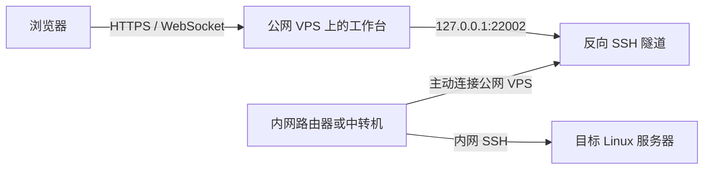

# 仅内网可访问的服务器外网访问方案

通过一台公网 VPS 和一台能够访问内网的路由器或中转机，在浏览器中使用内网 Linux 服务器的终端、文件树和代码编辑器。

成员使用目标服务器上各自已有的 Linux/SSH 账号登录。网页服务不另建一套用户体系，目录和文件操作遵循各自账户权限。



## 提供什么

- 交互式 SSH 终端：尺寸同步、全屏、输入输出和断线状态。
- 文件概览：个人主目录、目录展开、刷新和权限内的共享路径。
- 多标签编辑：Python、JavaScript/TypeScript、JSON、Markdown 高亮，以及查找、撤销和保存。
- 保存冲突检测：核对文件版本，再通过目标服务器支持的 POSIX 原子替换写入已有文件。
- 快速输入栏：在浏览器本地编辑单行命令，Enter 整行发送；原终端保留补全和交互程序操作。
- 简单连接诊断：分别查看网页往返、远程文件请求与终端处理时间。

## 适用条件

需要一台有公网入口的 VPS、一台可以主动连接 VPS 且能够访问目标 SSH 服务的内网路由器或中转机，以及目标服务器上可用的个人 SSH 账号。目标 SSH 服务需支持密码或单一密码提示的 keyboard-interactive 认证；文件功能需要 SFTP，保存还需要 `posix-rename@openssh.com` 扩展。

内网通路由中转机提供。如果访问目标服务器需要校园或企业 VPN，VPN 应先在中转机或它的上游配置完成。本项目负责网页工作台和 SSH 接入，不代替 VPN。

## 本地启动

需要 Node.js 20+、npm 和 `ssh-keygen`（测试使用）。先完成 [部署文档](docs/DEPLOYMENT.md) 中的反向 SSH 通道与目标主机公钥配置。

```sh
git clone https://github.com/QTSHI/intranet-server-access.git
cd intranet-server-access
npm ci --ignore-scripts
npm run vendor
npm run check
npm test
```

将从目标服务器可信控制台取得的 ED25519 **公钥**保存为 `config/campus-host-key.pub`，然后运行：

```sh
LAB_SSH_PORT=22002 \
LAB_ALLOWED_ORIGINS=http://127.0.0.1:8090 \
npm start
```

打开 `http://127.0.0.1:8090`。正式部署时，通过 Nginx 提供 HTTPS，并把 `LAB_ALLOWED_ORIGINS` 改为实际 HTTPS 来源。

仓库保留构建源码和锁文件。终端与编辑器的浏览器资源由 `npm run vendor` 生成，运行时不依赖外部 CDN。

## 配置

| 环境变量 | 默认值 | 用途 |
| --- | --- | --- |
| `LAB_PREVIEW_PORT` | `8090` | 网页服务监听端口，仅监听 `127.0.0.1` |
| `LAB_SSH_PORT` | `22002` | VPS 上的反向 SSH 回环端口 |
| `LAB_HOST_KEY_PATH` | `config/campus-host-key.pub` | 可信目标服务器 ED25519 公钥；相对路径以项目目录为基准 |
| `LAB_ALLOWED_ORIGINS` | `http://127.0.0.1:<网页端口>` | 允许的完整来源，多个来源以英文逗号分隔 |

浏览器不能指定 SSH 主机或端口。SSH 连接固定进入 VPS 本机回环通道，再由隧道到达内网目标。

## 部署与维护资料

- [架构与认证、文件和输入流程](docs/ARCHITECTURE.md)
- [从零部署：内网通道、公钥、VPS、Nginx、systemd](docs/DEPLOYMENT.md)
- [日常运维、故障排查、升级和回退](docs/OPERATIONS.md)
- [发布版验证记录](docs/VERIFICATION.md)
- [部署模板](deploy/)

## 验证

`npm test` 使用临时目录和本机模拟 SSH/SFTP 服务，不登录真实内网服务器。测试覆盖配置、认证、来源校验、终端数据、账户隔离、文件权限、保存冲突和资源释放。

浏览器测试使用真实 Chromium 与隔离 SSH 服务：

```sh
npx playwright-core install chromium
npm run test:browser:quick-input
npm run test:browser:editor
npm run test:browser:viewport
```

也可通过 `CHROME_PATH` 指定已有 Chrome/Chromium。测试报告与截图在本地生成，不纳入 Git 历史。CI 自动执行构建、语法检查和单元测试。

## 使用边界

单文件编辑上限为 256 KiB，最多打开 12 个编辑标签。保存针对已有的 UTF-8 普通文件；界面不提供任意文件创建、删除或上传功能。未保存草稿只存在当前页面中，刷新或关闭页面前应先保存。长时间任务可以在目标服务器上使用 tmux 等工具。

快速输入改善本地打字和编辑体验；命令执行与输出仍受实际网络影响。反向 SSH 通道上的丢包或暂停需要从中转机、出口和公网路径排查。

## 依赖许可

终端使用 xterm.js，编辑器使用 CodeMirror 6，SSH 和 WebSocket 分别使用 ssh2 与 ws。相关第三方许可保留在 [docs/licenses](docs/licenses/)；完整依赖以 `package-lock.json` 为准。仓库原创代码暂未指定开源许可证。
